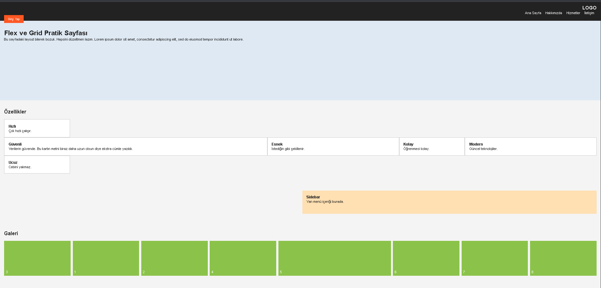
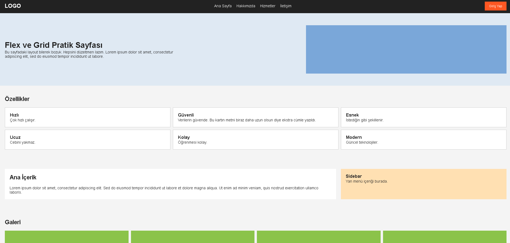
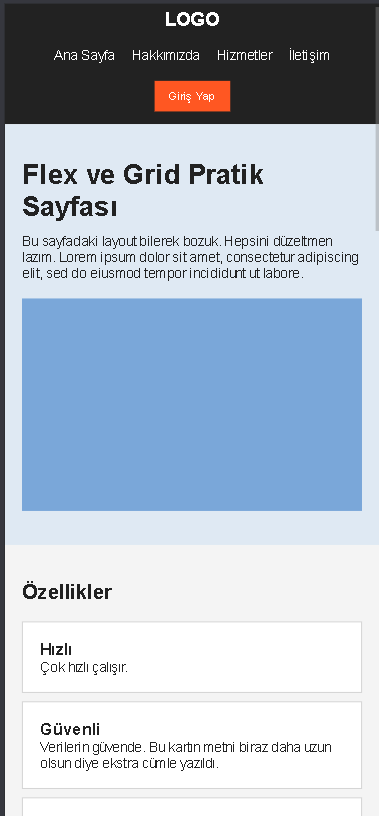
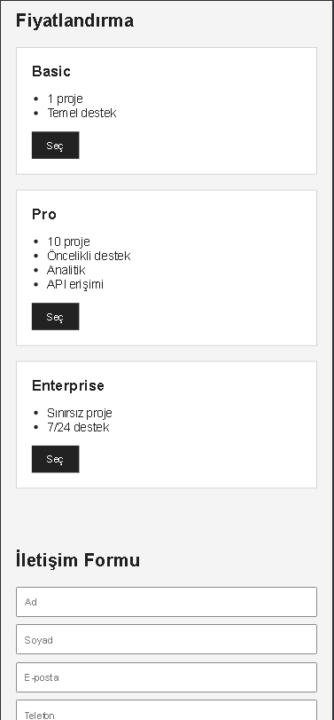

# Fix Bug Project

In this project, I fixed design and responsive layout issues in an existing web page.

## Before – Original Design

The original design with layout and responsive issues:

## After – Fixed Design

The updated design after fixing the issues:

## Improvements

- Fixed responsive design issues.
- Improved Flexbox and CSS Grid layouts.
- Enhanced mobile and desktop compatibility.
- Improved footer and navbar layouts.

## Technologies

- HTML5
- CSS3
- Flexbox
- CSS Grid
- Media Queries
